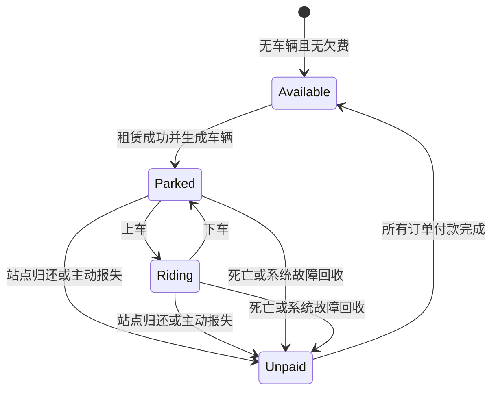

# 《逃离鸭科夫》共享单车 MOD 设计文档

版本：v0.1  
日期：2026-10-13  
状态：需求设计基线；首版代码已完成，施工与技术落地见《首版施工与试玩-1.0.0.md》，游戏验收待试玩  
适用范围：零号区、仓库区、农场镇；首版以单人游戏为目标

## 1. 目标与需求来源

在指定地图设置共享单车站点，玩家通过租车获得不受负重速度惩罚影响的移动能力。自行车不提供额外加速；骑行期间无法使用食物、药品或进行战斗。玩家需要归还车辆才能正常撤离，费用在归还或异常回收后形成订单，回地堡后到马蜂自提点付款。

本设计依据本次讨论和用户反馈整理。文中的“已确认规则”作为后续施工的需求基线；“设计默认值”是为补齐未指定细节而提出的首版方案，可以在施工前调整，不能描述为用户已经逐项确认。游戏内部类名、接口、地图坐标等均需后续验证。

### 1.1 已确认规则

| 编号 | 规则 |
| --- | --- |
| R01 | 零号区、仓库区、农场镇设置多个站点，可租车和还车。 |
| R02 | 可以随时下车、临时停车，再回到自己的车辆继续骑行；下车不等于还车。 |
| R03 | 可在任意站点归还，不要求回到最初租车站。 |
| R04 | 骑行只消除负重导致的速度惩罚，保留伤势、装备、技能及其他状态的速度影响，不实际修改背包重量。 |
| R05 | 骑行期间禁止使用食物、药品，禁止射击、近战、投掷物和攻击技能；已有药物效果可以继续生效。 |
| R06 | 有未归还车辆时，禁止租赁其他车辆，禁止正常撤离；可以继续使用自己已租的车辆。 |
| R07 | 收费为每小时200元，不足一小时按一小时计费。 |
| R08 | 按实际游玩时间累计；骑行、停车、战斗、搜刮均计时，暂停、退出游戏不计时。 |
| R09 | 死亡时系统自动回收未归还车辆，停止计时，并在租赁费之外追加2000元丢失车辆赔偿。 |
| R10 | 租赁结束后生成马蜂自提点待付款订单；现场不扣钱，点击“提取”时扣除现金。 |
| R11 | 现金不足时显示无法提取，订单保持未支付；存在任何未支付订单时禁止租车。 |
| R12 | 已归还、有欠费时允许撤离，玩家能够回地堡付款。 |
| R13 | 支持退出读档恢复租赁；提供报失回收；模组故障造成车辆无法恢复时自动回收结算，不追加故障罚款。 |
| R14 | 地图显示站点和已租车辆标记，界面显示租赁状态、时长、预计费用及明确的拦截原因。 |
| R15 | 首版站点不限车辆库存，不设置满桩、押金、车辆损坏或复杂驾驶物理。 |

### 1.2 首版设计默认值

| 项目 | 默认方案 | 说明 |
| --- | --- | --- |
| 冲刺与体力 | 骑行不允许冲刺；踩踏不消耗移动体力，也不额外恢复体力 | 体力自然恢复按原游戏规则处理，不移除其他体力消耗效果。 |
| 上下车 | 各约1秒的动作过渡 | 需试玩调整；过渡期间不允许攻击或使用消耗品。 |
| 骑行受击 | 按原游戏伤害规则受伤，不提供无敌或减伤；受击不自动下车 | 致死时立即执行死亡回收；其他强制角色状态按原游戏处理。 |
| 骑行交互 | 允许打开地图和背包、上下车；搜刮、拾取、对话和其他世界交互需下车 | 站点归还可以直接发起，成功后自动下车；骑行时禁止丢弃物品。 |
| 主动报失费用 | 租赁费外追加2000元回收赔偿 | 与死亡赔偿相同，避免主动报失比死亡处理更便宜。不是已确认的新金额。 |
| 付款资金来源 | 使用原游戏地堡交易采用的现金来源 | 包括哪些容器需接口验证；不凭空引入账户或赊账余额。 |
| 账单载体 | 马蜂中的专用结算订单，付款后自动完成，不占背包格子 | 保留用户要求的“提取”操作；历史账单在模组记录中保存。 |
| 初始站点数量 | 每张地图先规划3个站点，共9个 | 根据实际路线和地图结构增减，不预先编造坐标。 |
| 交互距离 | 上下车约2米，站点还车范围约4米 | 玩家与自己的车辆都必须位于本站还车范围内；需碰撞和可达性验证。 |
| 联机 | 首版仅验收单人模式 | 联机涉及车辆归属、计时和付款同步，单独设计。 |

## 2. 首版范围与完成标准

首版必须完成一条完整流程：站点租车 → 骑行/停车 → 任意站点还车 → 正常撤离 → 地堡马蜂付款 → 再次租车。

同时覆盖死亡回收、主动报失、退出读档、车辆恢复失败、重复点击和现金不足。只做速度修改、没有租赁与订单闭环的版本不算首版完成。

第一轮不实现车辆耐久、撞击伤害、摔车、站点库存调度、押金、信用等级、联机共享、离线收费或复杂驾驶物理。外观以可识别的自行车模型和基本骑行姿态为目标，具体资源方式在施工阶段确定。

## 3. 状态模型与基本约束

### 3.1 对玩家显示的状态

| 状态 | 描述 | 可租新车 | 可正常撤离 | 计时 |
| --- | --- | --- | --- | --- |
| 可租赁 | 没有有效租赁、没有待付款订单 | 是 | 是 | 否 |
| 租赁中·骑行 | 有一辆待归还车辆，角色在车上 | 否 | 否 | 是 |
| 租赁中·停车 | 有一辆待归还车辆，角色已下车 | 否 | 否 | 是 |
| 已结束·待付款 | 车辆已归还/回收，存在待付款订单 | 否 | 是 | 否 |



### 3.2 内部状态

- 租赁记录：`Active`（进行中）/`Closed`（已结束）。
- 骑乘状态：`OnFoot` / `Mounting` / `Riding` / `Dismounting`。
- 结算订单：`Unpaid` / `PaymentPending` / `Paid`。`PaymentPending`为内部付款处理中状态，不作为玩家可长期停留的业务状态。
- 租赁结束原因：`Returned`、`DeathRecovery`、`ReportedLost`、`SystemRecovery`。
- 死亡、归还、报失和系统回收都是租赁结束事件，同一租赁只接受一个有效结束事件。

### 3.3 必须始终满足的约束

1. 每个存档最多存在一份有效租赁和一辆对应车辆。
2. 有有效租赁或任何未支付单车订单，均不能租新车。
3. 是否骑行不决定是否欠车；停车后仍需还车。
4. 正常撤离只检查有效租赁，不因为历史欠费阻止撤离。
5. 每份租赁最多生成一份结算订单；死亡与主动报失赔偿不叠加。
6. 结束后金额冻结，待付款和退出游戏不继续增加费用，也不产生滞纳金。
7. 存档之间的租赁、车辆和订单完全隔离。
8. 重复事件、重复点击、重建界面和重新读档不会重复租车、开单或扣款。

## 4. 站点布局与租还交互

### 4.1 地图布局

| 地图 | 首轮规划 | 坐标状态 |
| --- | --- | --- |
| 零号区 | 入口可达处、主要搜刮区域外围、撤离路线附近各1个 | 待游戏内勘察 |
| 仓库区 | 入口可达处、主要搜刮区域外围、撤离路线附近各1个 | 待游戏内勘察 |
| 农场镇 | 入口可达处、主要搜刮区域外围、撤离路线附近各1个 | 待游戏内勘察 |

站点必须落在玩家和车辆都能到达的地面，避免阻挡原有道路、任务交互和撤离触发区。撤离附近的站点要留出正常步行距离，不能把还车交互直接覆盖到撤离倒计时上。地图存在多个相距较远的撤离路线时，可增加站点。

每个站点配置稳定的站点ID、显示名称、地图/场景ID、位置、朝向、还车范围和安全车辆生成点。配置以实际游戏场景验证结果为准。

“任意站点归还”表示不限定原租车站；归还时必须把车带到目标站点，不支持站在另一站点远程归还留在原地的车。跨地图搬运车辆的行为见第7.2节。

### 4.2 租车

1. 玩家与站点交互，查看价格、计时规则、骑行限制、撤离要求和死亡赔偿。
2. 租赁服务检查：角色存活、无有效租赁、无未付款订单、站点可用。
3. 检查安全生成位置，创建租赁记录和唯一车辆；只有全部成功才开始计时。
4. 默认将车生成在站点，玩家仍在步行状态，可自行选择上车。
5. 租车不扣现金、不检查是否付得起200元或2000元，不要求押金。

车辆创建失败时回滚租赁记录，显示“车辆生成失败，请稍后重试”，不产生最低200元费用。租车按钮处理期间不能重复触发。

### 4.3 上车与下车

- 只能上自己的有效租赁车辆，需处于交互距离内且角色可操作。
- 上车前结束瞄准、持续射击和未完成的消耗品使用；已完成的效果保留，已扣除物品的原游戏结果不回滚。
- 上车成功后启用骑行限制和负重速度补偿。
- 允许在有安全落脚点的位置下车；不能生成到墙体、地面下或不可站立位置。
- 下车动作完成后恢复原游戏的移动、战斗和物品规则，车停在原地，计费继续。
- 如无安全落脚点，上下车失败并提示原因；紧急故障情况下可使用报失回收。

### 4.4 还车

- 玩家及对应车辆均需进入目标站点的还车范围，车辆与站点应具有可达关系，不能隔墙判定成功。
- 骑行时直接选择归还，会执行安全下车、结束租赁、移除车辆和生成订单。
- 停车时也可归还，但不能只看玩家位置而忽略车辆位置。
- 成功后立即停止计时，显示订单金额和马蜂付款提示；不现场扣钱。
- 还车后直到付款前，所有站点均显示欠费租赁限制。

## 5. 骑行移动与行为限制

### 5.1 移动规则

目标语义：骑行速度等于“当前角色在当前状态下、仅去除负重速度惩罚后的正常步行速度”。不要使用一个固定高速值覆盖原游戏计算。

保留装备速度修正、伤势、技能、增益/减益、原游戏地形和碰撞限制。负重造成的减速属于需要消除的部分；非速度类负重效果不在本需求中自动免除。施工时需识别极度超重造成的移动锁定是否也是负重惩罚，不能只去掉百分比减速却仍被重量锁定为无法移动。

角色实际重量、背包容量、物品重量和拾取合法性均维持原值。零负重玩家骑车不会获得额外速度加成。下车后按照当时真实负重和角色状态重新计算速度，不恢复一个过期的缓存数值。

首版沿用原游戏移动方向控制，不新增驾驶惯性、极速或撞击机制。自行车必须遵守世界碰撞，不允许穿墙、穿门、跨越无法通行的地形；具体通道适配需要游戏内验收。

### 5.2 行为矩阵

| 行为 | 骑行/上下车过渡 | 步行且仍租赁中 |
| --- | --- | --- |
| 正常移动 | 骑行时允许；过渡中限制移动 | 按原游戏规则 |
| 冲刺 | 禁止 | 按原游戏规则 |
| 瞄准、开枪、近战 | 禁止 | 按原游戏规则 |
| 投掷物、攻击技能 | 禁止 | 按原游戏规则 |
| 吃食物、饮品、药品及其他恢复类消耗品 | 禁止 | 按原游戏规则 |
| 已生效的药物/状态持续 | 保留 | 保留 |
| 开地图、查看背包 | 骑行时允许；过渡中禁用新的操作 | 按原游戏规则 |
| 搜刮、拾取、丢弃、对话、任务/机关交互 | 需先下车 | 按原游戏规则 |
| 站点归还 | 骑行时允许发起 | 允许 |
| 正常撤离 | 有有效租赁则禁止 | 有有效租赁则禁止 |
| 主动报失 | 可从租赁面板发起 | 可从租赁面板发起 |

禁止行为需要在实际动作执行入口拦截，不能只隐藏按钮或禁用快捷键。覆盖鼠标、快捷栏、背包菜单及其他已识别入口。骑行时切换武器不能解除攻击限制。

## 6. 计时与计费

### 6.1 时间口径

从租赁成功时开始累计有效游玩时长，到正常归还、死亡回收、主动报失或系统回收时停止。

- 骑行、临时停车、下车战斗、搜刮、原地等待、上下车动作：计时。
- 真正暂停游戏、主菜单、退出游戏、读档/场景加载过程：不计时。
- 打开背包或地图是否计时取决于游戏是否实际暂停；若世界仍在运行，则继续计时。
- 使用累计有效时长，不直接用系统日期相减，不受改系统时间影响，不按游戏内昼夜时间倍率收费。
- 游戏改变模拟速度时，计时仍按未暂停的现实经过时间累计。

### 6.2 计费公式

设 `T` 为已累计的有效游玩时长，单位毫秒：

```text
计费小时数 H = max(1, ceil(T / 3,600,000))
租赁费 RentFee = H × 200
总金额 Total = RentFee + AdditionalFee

正常归还：AdditionalFee = 0
死亡回收：AdditionalFee = 2000
主动报失：AdditionalFee = 2000（设计默认值）
系统故障回收：AdditionalFee = 0
```

仅成功建立的租赁适用最低200元。租车成功后马上归还，即使累计时长为0，也按200元收费。

| 场景 | 租赁费 | 赔偿/回收费 | 总计 |
| --- | ---: | ---: | ---: |
| 成功租车后立即归还 | 200 | 0 | 200 |
| 10分钟归还 | 200 | 0 | 200 |
| 恰好60分钟归还 | 200 | 0 | 200 |
| 60分钟零1毫秒归还 | 400 | 0 | 400 |
| 恰好120分钟归还 | 400 | 0 | 400 |
| 10分钟时死亡，车辆未归还 | 200 | 2000 | 2200 |
| 70分钟时死亡，车辆未归还 | 400 | 2000 | 2400 |
| 已归还后死亡 | 不生成新账单 | 不追加赔偿 | 原账单不变 |
| 租车生成失败 | 0 | 0 | 0 |

显示时长可以精确到秒，但金额判断使用实际累计精度，不能按界面四舍五入后的分钟数计算。租赁记录保存租车时的价格与赔偿标准，后续修改配置不能改变旧租赁或旧账单金额。

## 7. 撤离与场景切换

### 7.1 正常撤离

有有效租赁时，不论车在身边、停在远处还是玩家已经下车，都禁止发起正常撤离。

检查应覆盖实际存在的回地堡撤离入口及替代撤离方式，而不只检查某一个撤离按钮。开始撤离前检查一次，实际完成撤离前再检查一次；有有效租赁时不进入有效撤离倒计时。死亡返回地堡单独走死亡处理，不被“禁止正常撤离”拦截。

拦截文案：

> 你还有一辆共享单车未归还，请先将车辆归还至任意站点。

显示最近可达站点；若暂时无法计算可达路线，则显示距离最近的站点并称为“最近站点”，不能误称“最近可达站点”。允许从提示进入租赁信息和地图，不自动远程还车。

已归还且有欠费时可以撤离。没有有效租赁时，本模组不改变原游戏撤离条件。

### 7.2 普通跨地图通道

普通地图切换必须与回地堡撤离区分，不一律套用撤离限制。当前尚未验证游戏的地图连接、实例生命周期和存档方式，以下为施工前必须验证的设计项：

- 默认方案：跨地图前下车；车留在原地图，租赁仍有效，切换加载期间不计时，进入可操作状态后继续计时。返回原地图时恢复同一辆车及位置。
- 原地图若无法再访问，或实例切换必然导致车无法恢复，需要先调整该通道的租赁处理方案。不能上线一个会把车辆留在无法返回地图的路径。
- 若要支持车辆随玩家跨地图，需单独确定安全生成、骑乘状态和地图标记迁移方案；首版不承诺该能力。
- 因技术故障丢失车辆时按系统回收处理；不能把用户主动离开不可返回地图作为免费的故障回收漏洞。

这一项必须在站点和地图全量铺设前完成验证，并把最终通道规则补入文档。

## 8. 马蜂订单与付款

### 8.1 订单生成

租赁结束时立即保存固定金额的结算订单，并将其登记到马蜂自提点。若当前不在地堡，返回地堡并打开自提点时应能看到订单。

一份租赁只生成一份订单；租赁费与死亡/报失赔偿作为同一订单的明细，一次支付。死亡赔偿不在死亡瞬间直接扣钱。

订单至少显示：订单编号、租车站、归还站或回收原因、有效租赁时长、计费小时数、租赁费、额外赔偿、总额和支付状态。墙钟起止时间仅供展示，不用于计算收费。

示例：

```text
共享单车结算单
有效租赁时长：00:18:24
计费时长：1小时（不足1小时按1小时计）
租赁费：200元
丢失自行车赔偿：2000元
合计：2200元
状态：待付款

[提取]
```

### 8.2 提取付款

1. 玩家点击“提取”。
2. 校验订单属于当前存档且仍未支付，锁定本次付款操作。
3. 从已验证的游戏现金来源读取余额。
4. 余额不足：不扣钱、不结清、不移除订单，显示所需金额、余额和差额。
5. 余额充足：一次扣除全部金额，将订单标记为已支付并持久化，再完成自提点订单。
6. 所有未支付单车订单结清后，恢复租车资格。

不提供分期、部分扣款或用物品抵扣。余额恰好等于金额时允许成功付款。成功后显示“付款成功，已恢复租车资格”；若仍有其他欠费，显示“付款成功，仍有其他订单待支付”。

### 8.3 一致性要求

- 连续点击、重复打开马蜂、界面重建、读档都不能导致重复扣钱。
- 原游戏若不支持付费自提订单，需要验证能否在马蜂交互流程中扩展结算；不能改成普通免费包裹，也不能未经需求变更把付款迁移到其他地点。
- 付款前保存包含订单ID、金额和状态的操作记录；扣款与订单保存需要与游戏存档的一致性机制配合，具体事务/恢复方案在接口验证后确定。
- 中断恢复不得盲目再次扣钱，也不得把未实际扣款的订单自动设为已支付。
- 不能把模组JSON里的“已支付”与游戏现金保存当作天然原子操作；要专门验收扣款前后退出、崩溃和读档。
- 账单订单不应因为没有背包空格而无法结算，也不能因丢弃或卖掉收据解除欠费。

## 9. 异常处理与存档恢复

| 情况 | 租赁处理 | 费用 | 玩家结果 |
| --- | --- | --- | --- |
| 骑行或停车期间死亡 | 立即结束租赁、退出骑行、自动回收车辆、生成订单 | 租赁费+2000元 | 允许按死亡流程回地堡，欠费禁止再次租车 |
| 无有效租赁时死亡 | 不执行单车回收 | 无新增费用 | 原游戏死亡流程 |
| 正常退出再读档 | 恢复同一租赁、同一车辆和累计时长 | 离线不计时 | 保留未还车限制 |
| 主动报失/车辆找不回 | 确认后结束租赁并回收车辆 | 租赁费+2000元，设计默认值 | 解除欠车限制，产生欠费 |
| 模组故障导致车辆无法恢复 | 尝试恢复；确实失败则自动结束并生成系统回收订单 | 截至最后有效计时的租赁费，不追加罚款 | 清除欠车状态，可撤离，付款后可再租 |
| 还车和死亡几乎同时发生 | 按已提交的第一个有效结束事件处理 | 正常还车先提交则无赔偿；死亡先提交则加2000元 | 只生成一份账单 |
| 玩家主动卡车/停到难以取回位置 | 可下车排障或主动报失 | 按主动报失规则 | 不自动认定为模组故障 |
| 车辆对象暂时未加载 | 先根据地图实例与租赁记录恢复 | 暂不重复开单 | 不因对象尚未出现而直接罚款 |
| 收费配置在租赁中被修改 | 继续使用租车时保存的价格快照 | 旧合同金额不变 | 新租赁采用新配置 |

主动报失放在租赁信息面板中，明确提示“车辆将被回收，本次租赁立即结束，并追加2000元回收赔偿；费用回地堡后在马蜂付款”，玩家确认后执行。取消不改变任何状态，也不停止计时。

存档恢复顺序：读取当前存档身份 → 加载租赁与订单 → 检查地图实例 → 重建车辆 → 恢复交互和地图标记 → 恢复计时。读档默认恢复为停车状态，避免把角色直接放入不安全的骑行姿态；这不改变车辆归属、位置和累计时长。

死亡回收必须覆盖临时停车，不只处理角色骑在车上的情况。反复触发死亡事件不得再次追加2000元。

运行中禁用模组应先移除骑行限制与速度补偿，保留业务存档，重新启用后恢复。模组未加载时无法执行本模组规则；卸载导致的绕过不在首版防作弊范围内，但不能把角色永久保存为异常速度或禁用战斗状态。

## 10. 界面与提示

### 10.1 租车须知

```text
共享单车
价格：200元/小时，不足1小时按1小时计费。
成功租车后开始计时，下车后继续计费；暂停和退出游戏不计时。
骑行消除负重减速，不额外加速；不能冲刺、战斗或使用食物药品。
可临时停车，并在任意站点归还。
车辆未归还时不能正常撤离，也不能租其他车辆。
死亡后车辆自动回收，除租赁费外需赔偿2000元。
费用回地堡后在马蜂自提点点击“提取”支付。
未付清订单前不能再次租车。

[租赁]  [取消]
```

### 10.2 持续提示

- 骑行：`骑行中｜租赁00:18:24｜当前费用200元｜下车后继续计费`。
- 停车：`车辆未归还｜租赁00:18:24｜当前费用200元`，可查看车辆地图位置。
- 下一小时即将开始：可提示下一档费用，但不自动续租确认；合同本就连续计费。
- 已结束欠费：在站点交互及租赁面板显示待付款总额，不需持续占用战斗界面。

“当前费用”指正常归还需要支付的租赁费，尚未发生的死亡赔偿不能计入；报失确认界面单独显示报失后的合计金额。

### 10.3 失败提示

| 情况 | 示例文案 |
| --- | --- |
| 有有效租赁时租新车 | 你还有一辆自行车未归还，请继续使用或归还当前车辆。 |
| 有欠费时租车 | 你有未支付的单车订单，请到地堡马蜂自提点付款。 |
| 骑行尝试攻击 | 骑行中无法战斗，请先下车。 |
| 骑行尝试吃药 | 骑行中无法使用食物或药品，请先下车。 |
| 骑行尝试搜刮 | 请先下车再进行此操作。 |
| 车辆不在还车范围 | 请将你租赁的自行车带入本站还车范围。 |
| 余额不足 | 无法提取：需支付2200元，当前现金1500元，还差700元。 |
| 正常还车成功 | 还车成功，本次费用200元，请到地堡马蜂自提点付款。 |
| 死亡回收 | 车辆已自动回收：租赁费200元，丢失赔偿2000元，合计2200元。 |
| 系统回收 | 车辆恢复失败，系统已回收；未追加赔偿，请到马蜂结算租赁费。 |

对持续按住按键产生的失败提示进行节流，避免每帧刷屏。

## 11. 技术设计与持久化

本节是职责规划，不代表游戏已提供这些接口。接入点必须通过本机安装版本的程序集和运行行为确认。

### 11.1 模块划分

| 模块 | 职责 |
| --- | --- |
| 站点管理 | 加载地图站点配置，生成交互对象与地图标记，处理安全生成与还车范围。 |
| 租赁服务 | 统一资格检查、创建租赁、结束租赁、事件去重、计算租赁状态。 |
| 骑行控制 | 上下车、姿态、车辆跟随/移动、碰撞、速度补偿和行为拦截。 |
| 计时计费 | 累计有效现实时间，保存价格快照，计算整数小时费用。 |
| 撤离适配 | 识别正常撤离、完成前检查及死亡返回流程。 |
| 马蜂结算适配 | 展示订单，读取合法现金来源，扣款并完成订单。 |
| 存档与恢复 | 存档隔离、租赁/车辆/订单保存、异常恢复和付款一致性记录。 |
| 界面提示 | 租赁面板、地图标记、价格须知和失败反馈。 |

### 11.2 最小数据模型

| 对象 | 关键字段 |
| --- | --- |
| 存档业务根 | schemaVersion、saveId、activeRentalId、订单索引 |
| 站点 | stationId、mapId/sceneId、name、position、rotation、returnRadius、spawnPoints |
| 租赁 | rentalId、saveId、vehicleId、status、rentStationId、returnStationId、elapsedActiveMs、hourlyRateSnapshot、deathPenaltySnapshot、reportFeeSnapshot、startDisplayTime、closeReason、closedDisplayTime、orderId |
| 车辆 | vehicleId、rentalId、mapId/sceneInstanceId、position、rotation、恢复所需信息 |
| 订单 | orderId、rentalId、saveId、durationMs、billedHours、rentFee、additionalFee、total、closeReason、paymentStatus、paidDisplayTime |
| 付款操作记录 | operationId、orderId、amount、执行阶段、现金变更与游戏存档的关联信息 |

业务根和运行时车辆对象分开保存。不能仅通过“场景中找到一辆自行车”推断归属，也不能仅通过马蜂界面是否有包裹判断欠费。

租赁创建、归还、死亡、报失、系统回收和付款属于关键持久化节点。持续计时可定期保存，设计默认间隔5秒，并在正常存档/退出时同步保存；崩溃可能损失最后一个周期的未保存时长，不能把退出后离线时间补算进去。车辆移动后的位置也需周期保存及关键节点保存。

付款记录的具体字段和恢复步骤，需要先确定原游戏存档及货币扣款机制，再写成可执行技术方案。不得以这张抽象数据表替代支付一致性验证。

### 11.3 第一阶段接口验证清单

1. 游戏版本、模组入口和所需运行库，适配当前安装环境。
2. 当前玩家识别、真实负重和速度计算链，特别是极端超重锁定。
3. 食物、药品、射击、近战、投掷物和技能的实际执行入口。
4. 场景加载、地图标记、世界交互、碰撞与安全下车位置查询。
5. 正常撤离入口、实际完成入口、死亡事件和返回地堡顺序。
6. 马蜂订单类型、列表扩展、提取回调与付费结算可行性。
7. 现金来源、扣款API、游戏存档提交与模组数据的恢复机制。
8. 三张地图的实际场景ID、跨地图通道与实例是否可恢复。

## 12. 验收场景

下表用于后续施工验收，其中时间和金额场景可通过可控制的计时输入验证；移动、站点、马蜂和死亡流程必须在游戏内验证。

| 编号 | 操作/前提 | 预期 |
| --- | --- | --- |
| A01 | 各目标地图进入后查看站点 | 所有配置站点正常生成、可交互、不阻挡原游戏行为。 |
| A02 | 无欠车欠费、现金为0时租车 | 租车成功，不扣现金；最低费用从成功租赁起适用。 |
| A03 | 租车创建失败或连点租车 | 失败不留记录；成功最多创建一辆车、一份租赁。 |
| A04 | 相同装备/伤势，分别以零负重和高负重骑行 | 骑行速度一致；高负重下车后恢复原负重减速。 |
| A05 | 零负重骑行对比零负重步行 | 不额外加速，不可冲刺。 |
| A06 | 骑行期间伤势或速度状态发生变化 | 相应速度影响生效，不能固定为上车时的速度。 |
| A07 | 极度超重时上车与下车 | 骑行不受负重移动锁定；下车恢复正常重量规则。 |
| A08 | 骑行/过渡时从所有已识别入口尝试战斗、投掷、吃药 | 均不能执行；下车后恢复。 |
| A09 | 上车前已吃药，或正持续开枪/使用药品 | 已生效效果继续；未完成动作和持续射击不能带入骑行。 |
| A10 | 下车停车10分钟后骑回原车 | 计费连续；允许上原车，禁止租新车。 |
| A11 | 玩家到站但车不在站内，或隔墙停放 | 不能还车。 |
| A12 | 将车骑到非原租车站并归还 | 正常归还，车辆移除，计时停止，生成一份订单。 |
| A13 | 0、1毫秒、60分钟、60分钟零1毫秒、120分钟分别结束 | 租赁费依次200、200、200、400、400元。 |
| A14 | 停车、战斗、搜刮、真正暂停、退出再加载 | 活跃游玩累计；暂停、离线和加载排除。 |
| A15 | 骑行或停车未归还时尝试所有正常撤离方式 | 均拦截并提示；不进入有效撤离倒计时。 |
| A16 | 正常归还但未付款时撤离 | 允许按原游戏条件撤离；禁止再次租车。 |
| A17 | 无租赁无欠费时使用原游戏撤离 | 本模组不影响。 |
| A18 | 10分钟租赁时骑行死亡，或停车后死亡 | 自动回收且回地堡正常；只生成2200元订单。 |
| A19 | 70分钟时死亡，或死亡事件重复触发 | 合计2400元；重复事件不追加费用。 |
| A20 | 已归还欠费状态再次死亡 | 原订单不变，不追加2000元。 |
| A21 | 马蜂余额不足、余额恰好足够、连续点击提取 | 不足不扣款且保留订单；足额只扣一次并结清。 |
| A22 | 付款前后正常退出、崩溃、读档 | 不重复扣款，不出现无扣款却结清；恢复路径有证据。 |
| A23 | 租赁中正常退出，重进同地图或返回原地图 | 同一车辆位置与租赁恢复；不会重新开始首小时。 |
| A24 | 车辆技术恢复失败 | 结束租赁，无2000元额外罚款；恢复撤离资格。 |
| A25 | 主动报失并确认/取消 | 确认按默认规则加2000元；取消不结束或暂停租赁。 |
| A26 | 多存档切换、界面重建、地图加载 | 租赁与欠费不串档，订单/车辆不重复创建。 |
| A27 | 自提点背包已满、丢弃任意收据 | 不因背包格子影响付款；收据不能替代真实欠费状态。 |
| A28 | 原游戏现金扣款后界面或模组保存失败 | 按已验证恢复流程保持现金与订单一致，不能再次扣款。 |
| A29 | 骑行碰墙、过门、下车点受阻 | 不穿墙，不把角色放入无效地形；失败提示可理解。 |
| A30 | 一局重复租还、付款后再租 | 状态正确循环，无残留速度补偿、禁用操作或旧车辆标记。 |

## 13. 施工顺序

### 阶段0：验证接入条件

确认本机游戏路径和版本，检查程序集，完成第11.3节接口验证。优先解决负重速度、马蜂付款、撤离拦截、付款持久化和地图实例生命周期。

交付：接口核查记录、实际地图/站点配置草案、付款一致性方案、跨地图最终规则。若马蜂接入方式或地图切换必须改变产品行为，记录需求差异后再进入相关编码。

### 阶段1：实现租赁业务闭环

先在一张地图的两个测试站点实现资格检查、租赁/归还、有效时长计费、保存恢复、马蜂付款和撤离限制。使用简单车辆占位资源验证规则。

交付：能从租车走到付款再租车的可运行原型，计费和订单去重验收通过。

### 阶段2：实现骑行与异常处理

加入自行车外观、上下车、负重速度补偿、动作拦截、死亡赔偿、报失回收和系统故障恢复。完成碰撞与支付中断验收。

交付：原型具备完整骑行取舍和异常收尾，未归还车辆不会造成无法解除的业务状态。

### 阶段3：铺设三张地图并完善提示

配置全部站点、地图标记、租赁HUD、租车须知和马蜂账单文案，实际跑通各地图常用满载返程路线。

交付：完成全部首版验收场景，记录游戏版本、适配情况和站点坐标；形成可安装的首版模组包及使用说明。

## 14. 施工前待落地项

下列项目不改变已确认的核心规则，但必须在对应实现之前形成记录：

| 项目 | 本版处理 |
| --- | --- |
| 冲刺、体力、上下车时长、骑行交互范围 | 采用第1.2节设计默认值；可依据试玩调整。 |
| 主动报失回收费 | 暂定额外2000元；与已确认的死亡2000元赔偿分别记录。 |
| 站点数量、坐标与可达路线 | 初始每图3站；游戏内勘察后确定。 |
| 现金来源 | 接入原地堡交易现金规则，验证具体容器范围和扣款顺序。 |
| 马蜂账单形式 | 目标为专用结算订单，不占背包；以接口核查确定实现方式。 |
| 普通跨地图行为 | 原图留车和恢复为默认方案；实例不可恢复的通道必须补充处理方案。 |
| 自行车模型、姿态与碰撞尺寸 | 在资源及游戏运行验证后确定，不以改移速代替骑车体验。 |
| 游戏版本与其他模组兼容 | 首版适配目标版本待核查；有相同移动/输入/撤离/货币修改的模组需针对性验证。 |

## 15. 后续变更原则

后续施工以本文件为产品需求基线。修改收费、死亡赔偿、撤离限制、付款地点、骑行收益或跨地图体验时，更新版本和变更记录，再同步实现及验收表。

| 版本 | 日期 | 内容 |
| --- | --- | --- |
| v0.1 | 2026-10-13 | 根据用户反馈建立首版设计：整小时200元计费、死亡额外赔偿2000元、站点租还、骑行限制、撤离检查和马蜂付款闭环。 |
| v0.2落地记录 | 2026-10-14 | 核心收费与玩法不变。首版1.0.0按三地图各三地标寻位，马蜂使用不占格的专用结算面板；普通子场景允许停车后通行，未证实双向返回的主地图通道须先还车，含原生标明不可返回的零号区→仓库区。原生同文件保存现金、回执及订单，并原子替换完整文件。默认骨架姿态及程序化踩踏已实现，实际游戏待验收。 |
